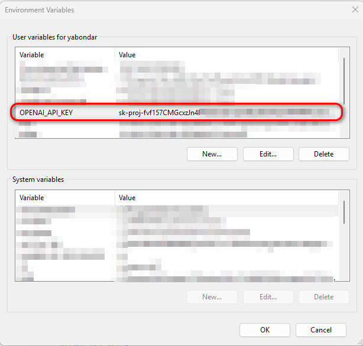

### Add the OpenAI API key manually in Windows

1. Press **Win+R**, enter the following, and press Enter:

   ```text
   rundll32 sysdm.cpl,EditEnvironmentVariables
   ```

2. Click **New**, in **User variables** section. <br>
    - Var name: **OPENAI_API_KEY**
    - Var value: ***PASTE_YOUR_API_KEY_HERE*** 

*** no Bearer prefix.


    
### Configure the Codex provider

1. Back up existing **%USERPROFILE%\.codex\config.toml**. 

2. In **config.toml** add the following on top before the first [section] header. Copy and paste the following into line 2. Then save and close the file.

    ```toml
    # Place this at the top level, before any [section].
    model_provider = "openai_api"
    
    [model_providers.openai_api]
    name = "OpenAI API"
    base_url = "https://api.openai.com/v1"
    env_key = "OPENAI_API_KEY"
    wire_api = "responses"
    ```
---

